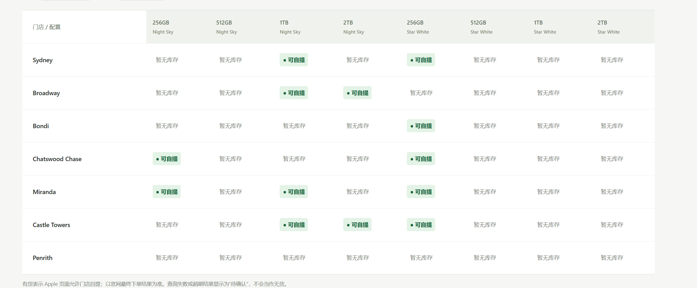

# iPhone 悉尼库存监测

Windows 本机后台 + 中文管理网页 + Chrome 扩展。默认监测 Apple 澳洲 **iPhone Duo：256GB / 512GB / 1TB / 2TB × Night Sky / Star White**，覆盖悉尼 7 家门店。另有 **iPhone 18 Pro 256GB Black** 真实库存测试选项。

读取公开自提库存，不登录 Apple、不加购物车、不自动下单。库存以 Apple 最终下单页面为准。

**当前采集器版本：1.3.3 · Windows 本地运行 · 无需服务器、Docker 或数据库。**



截图为界面示例，不代表实时库存。每一列是独立的「容量 + 颜色」配置；绿色表示该门店对应配置可自提。

## 安装前准备

| 项目 | 要求 |
| --- | --- |
| 电脑 | Windows 10 / 11；本项目的启动脚本和声音弹窗面向 Windows |
| Python | 3.12 或更新版本，安装时勾选 Add python.exe to PATH |
| 浏览器 | Google Chrome，允许加载开发者模式扩展 |
| 网络 | 可访问 Apple 澳洲官网；电话功能另外需要访问 Twilio |
| 电话账户 | 可选。不使用电话时，无需 Twilio，Windows 弹窗仍可用 |

普通使用者不需要 Git、Node.js、pip 安装、域名或云服务器。首次安装默认暂停监测，电话默认关闭。

## 给朋友使用（Windows）

1. [下载最新源码 ZIP](https://github.com/robber-857/Iphonescript/archive/refs/heads/main.zip)，或 GitHub → **Code → Download ZIP**，解压到固定文件夹，例如 `C:\Iphonescript`。进入能看到 `start.cmd` 和 `collector` 的那一层文件夹，不要在 ZIP 内直接运行。
2. 安装 [Python 3.12 或更新版本](https://www.python.org/downloads/windows/)，安装时勾选 **Add python.exe to PATH**；安装最新版 [Google Chrome](https://www.google.com/chrome/)。无需 Node.js，也无需 pip 安装第三方依赖。
3. 双击 `start.cmd`，打开本地后台 `http://127.0.0.1:8765`。重复启动会打开现有后台。
4. 在 Chrome 地址栏输入 `chrome://extensions` → 打开 **开发者模式** → **加载已解压的扩展程序** → 选解压目录内的 **collector 文件夹**（不是项目根目录）。
5. 手动打开 Apple Duo 或 Pro 的具体商品配置页，点击 Chrome 工具栏的“Duo 悉尼库存采集器”图标（未固定时从拼图菜单选择），看到“已选”即完成绑定。回到后台，默认选择 **iPhone Duo**、邮编 **2000**；保存设置并点击 **开始监测**。
6. 先点击 **测试提醒** 验证 Windows 弹窗。电话提醒需要另外配置，见下文。

可从这个 [Duo 256GB Night Sky 商品页](https://www.apple.com/au/shop/buy-iphone/iphone-duo/7.6-inch-display-256gb-night-sky) 开始指定采集页；网址失效时请从 Apple 澳洲官网进入支持的具体配置页。扩展会复用这个标签页依次检查所有配置，不需要手动打开 8 个页面。采集过程中不要手动切换这个弹窗的颜色或容量，以免配置校验失败。

安装成功的标志：扩展图标显示“已选”，管理页不再显示“等待浏览器采集器连接”，开始监测后能看到当前配置名称；等整轮完成，表格出现有效库存状态。首次检查可能需要几分钟，间隔选项是整轮结束后的等待时间。

每个人都在自己的电脑安装同一个 collector 文件夹即可，不需要单独制作扩展。此版本未上架 Chrome Web Store，故需要手动加载；企业管理的 Chrome 可能禁止开发者扩展。不要移动已加载的 collector 文件夹。

**分享仓库链接、GitHub 下载 ZIP 或 `dist/Iphonescript.zip` 即可。不要直接打包你的工作目录，更不要分享 `data/`，其中包含个人电话凭据和监测记录。** `package.ps1` 会只打包源码、说明和扩展，不包含个人数据。

## 日常启动、暂停和更新

- **启动：**双击 `start.cmd`。后台在本机运行，管理地址是 [http://127.0.0.1:8765](http://127.0.0.1:8765)。
- **暂停：**管理页点击“暂停监测”；正在执行的单个配置可能完成后才停止。
- **关闭网页：**只关闭管理页不会停止后台；仍需保留 Chrome 和已指定的 Apple 页。
- **重启电脑后：**再次运行 `start.cmd`，重新打开 Apple 商品页并点击扩展图标指定采集页。后台会恢复此前保存的监测开关。
- **完全退出后台：**先暂停，在 Windows 任务管理器的“详细信息”中显示“命令行”列，找到命令行指向本项目 `server.py` 的 Python 进程并结束它。不要结束其他项目的 Python 进程。不确定时可先暂停，再重启电脑。

更新必须同时更新 Python 后台和 Chrome 扩展：

1. 先暂停监测，并按上面方法退出本项目后台。
2. 下载最新 ZIP，将源码覆盖到原安装目录；保留自己的 `data` 文件夹，且不要把它分享给别人。
3. 双击 `start.cmd` 启动新后台。**已有后台运行时，重复双击只打开旧后台，不会加载新 Python 代码。**
4. 打开 `chrome://extensions/`，重新加载“Duo 悉尼库存采集器”，确认版本 **1.3.3**。如果换了安装目录，需要移除旧扩展并重新加载新目录内的 `collector`。
5. 刷新 Apple 商品页，点击扩展图标重新指定采集页，确认“已选”；刷新管理网页，然后开始监测。

仅刷新网页不会更新后台代码；仅重启后台不会更新扩展代码。

## 运行和监测设置

- 机型：默认 Duo 全部 8 个配置；Pro 测试仅检查 256GB Black，避免把测试机型库存误认为 Duo 补货。
- 邮编可编辑，默认 2000 时监测 Sydney、Broadway、Bondi、Chatswood Chase、Miranda、Castle Towers、Penrith。其他邮编（例如墨尔本 3000）监测 Apple 当前配置库存区域返回的附近门店；首次成功采集后显示门店列表。需要重新加载扩展 1.3.3 并刷新 Apple 商品页。
- 每轮完成后等待：30 秒、1 分钟、2 分钟、5 分钟（默认）。采集器约每 30 秒唤醒一次，浏览器调度可能导致实际开始稍晚；一轮查询自身也需要时间。
- 关闭管理网页不影响采集；必须保持 **Python 后台、Chrome、Apple 采集标签页** 运行，电脑联网且不休眠。每个配置开始查询时会将指定页切到前台。
- 退出 Python 后台或 Chrome 会停止检查；不开机自启。重启电脑后再次双击 `start.cmd`，会恢复已保存的监测开关。
- 颜色/容量筛选只改变表格展示；“监测机型”保存后才改变采集范围，切换会清空旧结果。
- 绿色 **● 可自提** 表示页面明确有货；查询错误、未知文案或过期显示 **待确认**，不会误报无货。
- 首次发现有货、或缺货后再次有货才触发提醒，持续有货不重复提醒。

## 用 iPhone 18 Pro 验证有货界面

设置中选 **iPhone 18 Pro（测试 · 256GB Black）** → 保存 → 立即检查（如已在查询，等待完成）。页面会采集真实 Apple 库存，有货时显示绿色格子并产生带 **Pro 测试** 标记的 Windows 提醒。测试机型**不触发自动电话**；测试完成切回 Duo 并保存。

该测试仍读取实时页面，不保证测试时有库存。

## 电话提醒：Twilio Voice

推荐 [Twilio Programmable Voice](https://www.twilio.com/docs/voice/api/call-resource)。后台通过 Twilio 官方语音模板发起来电提醒，无需公网服务器、域名或端口映射。真实电话会产生服务商费用；本项目不提供电话服务账户。

1. 自行注册 [Twilio](https://www.twilio.com/try-twilio)，按控制台指引完成账户验证。
2. 准备支持 Voice 的 Twilio 拨出号码，确认可拨打接听号码所在国家/地区、余额及相应地域拨号权限。号码购买、身份/地址材料要求及价格以控制台为准。
3. 从 Twilio 控制台获取 **Account SID** 与 **Auth Token**。不要把它们发到 GitHub 或公开聊天。
4. 在本地后台“电话提醒 · Twilio”填写 SID、Token、Twilio 拨出号码、自己的接听号码。号码用 E.164 格式，例如澳洲 `04xx...` 转为 `+614xx...`。
5. 保存后点击 **拨打测试电话**，界面会确认目标号码尾号及费用；接听后会听到 Twilio 官方示例语音。试用账户只允许已验证号码，并受国家及其他试用限制，参见 [官方试用说明](https://www.twilio.com/docs/usage/trials/try-out-voice)。
6. 测试成功后，勾选 **开启 Duo 自动电话提醒** 并保存。Windows 弹窗开关与电话开关独立。

补货时整轮合并为一通电话，看到来电后查看后台库存。测试和自动提醒均使用 Twilio 官方示例语音，不播报机型和门店。至少间隔 **1 分钟**，不设每日拨号次数上限。测试和失败/结果不明的尝试也计入冷却，重启后冷却仍保留。限流时仅记日志、不补拨；持续有货不重拨。电话未接听也不会无限重试；账户未开通或网络异常时请检查后台记录及 Twilio 通话日志。

界面的“Twilio 已接受拨号请求”**不代表对方已接听**；接通/忙线/失败以 Twilio 通话日志为准。没有填入真实凭据时不会打电话。

凭据保存到本机 `data/phone.json`（未加密，只应由你信任的本机账户访问），不在 `/api/state` 返回；页面只显示号码尾号，重新保存时留空保留旧值。每位使用者应使用自己的 Twilio 账户和号码，避免共用你的密钥和账单。

## 开发和打包

### 采集修复 1.3.3

只读取当前配置的主自提区域，排除 `Similar models available` 推荐机型；同时校验主标题、已选容量/颜色、邮编和门店商品编号。库存尚未完整渲染时最多等待 15 秒，失败记录会列出缺失/重复门店或无法识别的文案，不将未知状态当成有货。

更新后在 Chrome 扩展管理页重新加载“Duo 悉尼库存采集器”，确认版本为 **1.3.3**，再到 Apple 商品页点击扩展图标重新指定采集页。仅刷新管理网页不会更新扩展代码。

仅 Python 标准库。测试：

```powershell
python -m unittest test_monitor test_backend test_phone -v
node --test test_page_input.cjs
node --test test_inventory_scope.cjs test_pickup_trigger.cjs test_collector_binding.cjs test_cookie_cleanup.cjs
```

Node.js 仅用于开发测试，不是使用脚本的依赖。运行 `powershell -ExecutionPolicy Bypass -File package.ps1` 生成干净分享包 `dist/Iphonescript.zip`。

- `server.py`：API、任务分发、持久化、Windows 提醒。
- `monitor.py`：机型、门店和补货状态判断。
- `phone.py`：Twilio 外呼、凭据和拨号冷却。
- `collector/`：Chrome 扩展 1.3.3，真实页面采集。
- `web/`：本地管理页面。
- `data/`：仅本机数据，禁止分享。

此工具只在 `127.0.0.1:8765` 监听。Apple 页面变化、访问限制或验证码可能中断采集；无法保证持续可用。它不会绕过验证或自动购买商品。

扩展 1.3.0 同时识别 Check availability 和库存区域的门店名称入口（如 Apple Sydney）。更新后需在 Chrome 扩展管理页重新加载一次扩展。

采集页由用户手动打开并点击扩展图标指定。扩展不再新建、搬移标签页；只在指定页切换配置和刷新查询。关闭指定页、离开支持的商品页或重启 Chrome 后需重新指定。更新扩展也会清除旧绑定。手动指定不能保证避免 Apple 的请求限制，HTTP 541 仍应按查询失败处理。

## 每轮清理 Apple Cookie（可选）

默认关闭。在监测设置中勾选后保存：整轮配置采集结束 → 清除指定 Chrome Cookie 存储区内 apple.com 及其子域 Cookie → 开始计算 30 秒／1 分钟／2 分钟／5 分钟间隔。不清理其他网站、缓存或密码。会影响同一 Chrome 配置内所有 Apple 页面的登录、购物袋和偏好；建议在专门用于监测的 Chrome 配置中使用。清除 Cookie 不保证避免 HTTP 541。失败时记录日志并暂停监测，不继续查询。扩展 1.3.0 新增 cookies 和 Apple 子域访问权限，更新后须在 Chrome 确认权限并重新指定采集页。

## 常见问题

| 现象 | 检查方法 |
| --- | --- |
| 双击启动失败、找不到 python | 在新打开的终端运行 `python --version`；确认已安装 Python 并添加到 PATH。安装后重新打开终端再试。 |
| 管理页打不开 | 确认使用 `http://127.0.0.1:8765`；查看安装目录的 `data-server-error.log`。端口被其他程序占用时不要盲目结束未知进程。 |
| 一直等待采集器连接 | 检查扩展已启用、版本为 1.3.3；在具体 Apple 商品页点击扩展图标，确认显示“已选”。 |
| 显示配置不匹配 | 不要在正在采集的弹窗里手动切换配置；等待下一轮重新加载。检查后台机型与指定商品页是否匹配。 |
| 缺少门店、未知文案、HTTP 541 或验证码 | 本次结果无法确认，并不等于无货。查看指定 Apple 页和记录，必要时暂停、手动完成正常页面操作后重试；不要用缩短间隔反复请求。 |
| 还在出现“库存列表不完整或文案无法识别”旧错误 | 先看日志时间。新产生的旧文案通常说明扩展未更新；重新加载正确目录的扩展并刷新 Apple 页。 |
| 官网看起来有货，表格却无货 | 对照相同的容量、颜色、门店及查询时间。`Similar models available` 是其他配置，`Ships ...` 是配送日期，均不代表当前配置可自提。 |
| 有 Windows 弹窗但没有电话 | 两个开关独立；确认电话已配置并启用。自动电话在整轮结束时合并发起，检查电话记录、1 分钟冷却和 Twilio 通话日志。 |
| 电话仍提示每日最多 3 次或间隔 10 分钟 | 这是旧后台规则。按“更新”步骤真正退出并重启后台，不能只重复双击启动文件。 |
| 电话 HTTP 400 / Twilio 错误码 | 查看后台给出的具体错误码，再检查服务商账户、号码验证及拨号权限；“已接受请求”不代表已接通。 |

排查时可提供扩展版本、错误发生时间和脱敏后的错误文字；不要公开 `data/phone.json`、Auth Token 或完整电话号码。
